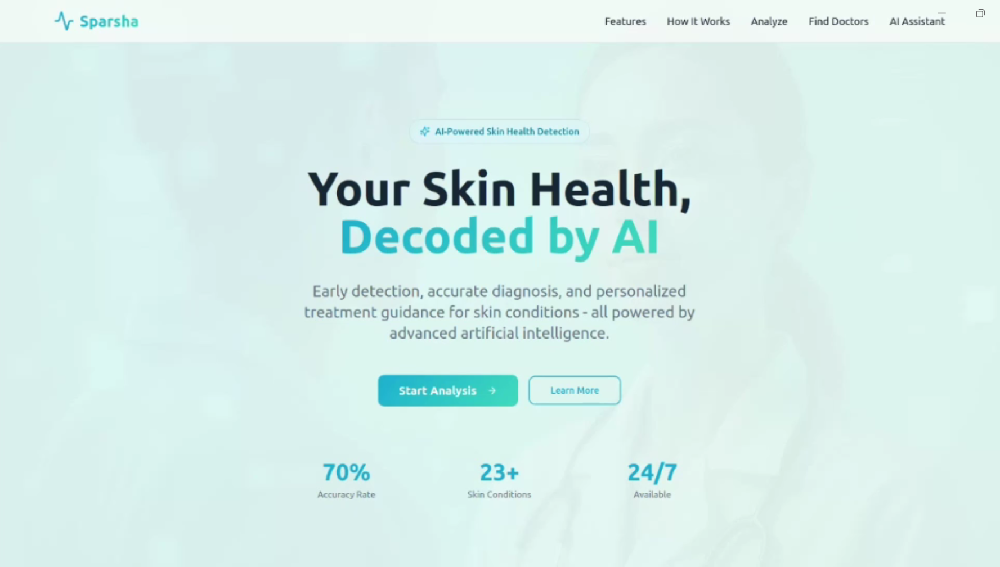
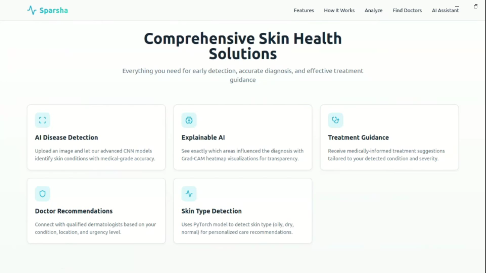
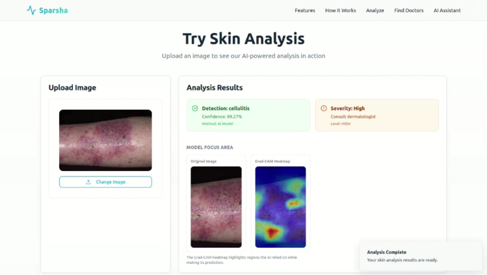
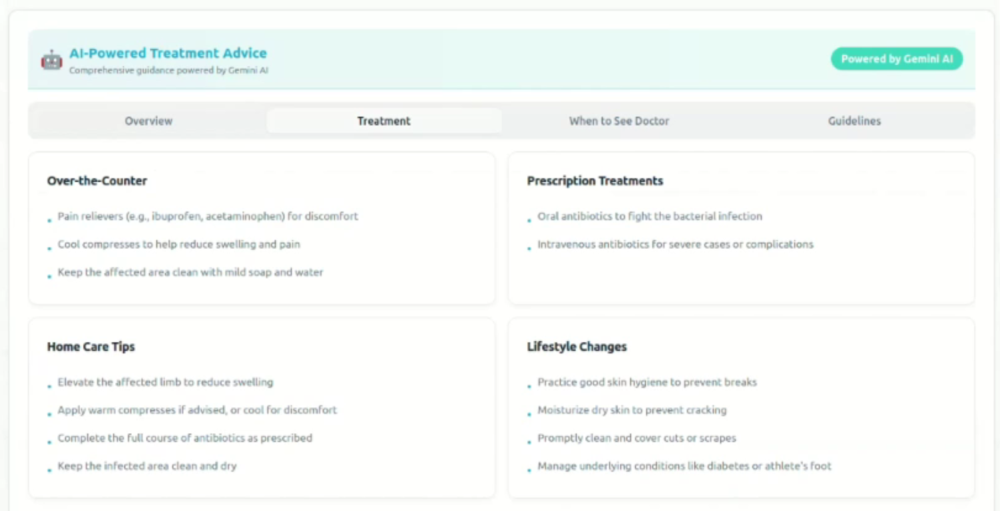
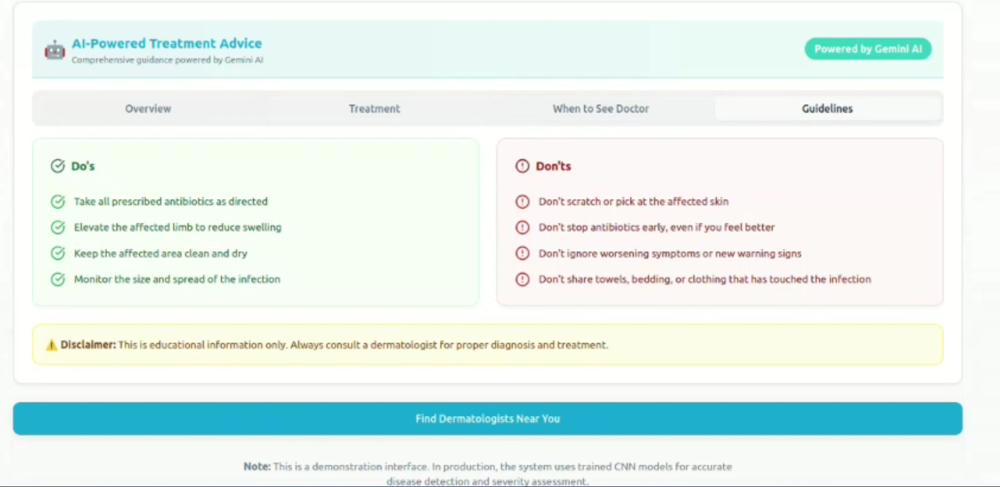
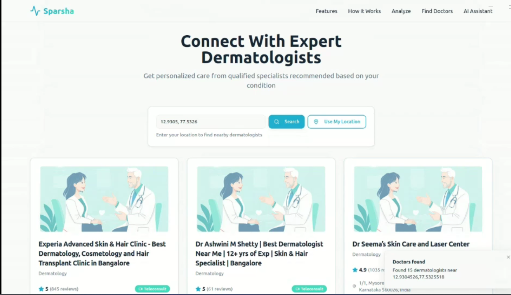
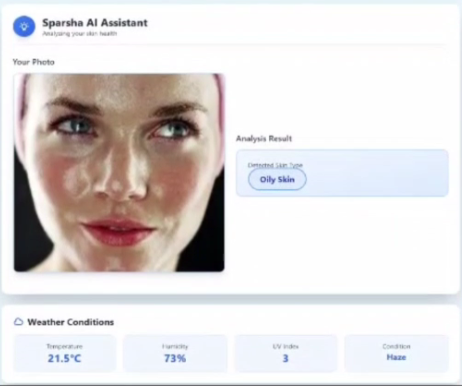

# Sparsha  
### AI-Powered Skin Disease Detection and Personalized Skincare Assistant  

Sparsha is an end-to-end AI healthcare platform developed as part of the **PAML Workshop hosted by the Center for Innovation and Entrepreneurship (CIE), PES University**, where the project was recognized as an **Honourable Team**.

The system combines computer vision, explainable AI, and agent-driven reasoning to improve accessibility to preliminary skin health guidance. It enables automated skin disease detection from images and generates confidence-aware treatment insights along with personalized skincare assistance.

---
## Live Deployment  

The Sparsha web application is deployed and accessible online.

You can test the complete pipeline including image upload, disease prediction, explainability visualization, and personalized skincare guidance using the link below.

🔗 **Open Application:**  
[Launch Sparsha](https://bandosmonkies.github.io/Skin-Disease-Detection/)

> Note: The first prediction may take a few seconds due to model initialization on the server.

---

## Application Workflow

### Dashboard Overview


### Comprehensive Skin Health Menu


### Skin Disease Detection


### Treatment Recommendations


### Personalized Treatment Plan


### Locate Specialists


### AI Dermatology Agent


----

## Key Features  

### Skin Disease Detection  
- EfficientNet-based convolutional neural network trained on 23 dermatological disease classes  
- Dataset of approximately 19,500 clinical images sourced from DermNet  
- Around 15,500 images used for model training  
- Multi-class disease classification pipeline implemented using PyTorch  
- Grad-CAM based explainability module to visualize model attention regions in addition to severity prediction and risk stratification  

### Personalized Skincare Assistant  
- Vision Transformer model for skin type classification with approximately 85% test accuracy  
- Agent-driven recommendation system using large language model reasoning  
- Context-aware personalization using environmental and user attributes  

### Doctor Discovery Module  
- Location-based dermatologist search using Geoapify Places API  
- Automated geocoding and radius-based clinic discovery  
- Structured output including clinic address and contact information  

### Full-Stack Deployment  
- React and Tailwind CSS frontend with image upload interface  
- FastAPI backend for model inference and AI response orchestration  
- Integrated end-to-end pipeline from image upload to guidance generation  

---

## System Architecture
```text
┌─────────────────────────────────┐
│        User Image Input         │
└────────────────┬────────────────┘
                 │
                 ▼
┌─────────────────────────────────┐
│  Skin Disease Classification    │
│           Model (CNN)           │
└────────────────┬────────────────┘
                 │
                 ▼
┌─────────────────────────────────┐
│      Confidence Evaluation      │
└────────────────┬────────────────┘
                 │
                 ▼
┌─────────────────────────────────┐
│   Explainability (Grad-CAM)     │
│        Visualization            │
└────────────────┬────────────────┘
                 │
                 ▼
┌─────────────────────────────────┐
│    AI Guidance Generation       │
└────────────────┬────────────────┘
                 │
                 ▼
┌─────────────────────────────────┐
│  Location-Aware Doctor Search   │
└────────────────┬────────────────┘
                 │
                 ▼
┌─────────────────────────────────┐
│  Personalized Skincare          │
│   Recommendation Engine         │
└────────────────┬────────────────┘
                 │
                 ▼
┌─────────────────────────────────┐
│    Frontend Output Interface    │
└─────────────────────────────────┘
```
---

## Model Training Overview  

### Skin Disease Classifier  
- Architecture: EfficientNet  
- Framework: PyTorch  
- Classes: 23 dermatological conditions  
- Dataset: DermNet clinical image dataset  
- Training techniques: normalization, resizing, augmentation  
- Explainability support through Grad-CAM  

### Skin Type Classifier  
- Architecture: Vision Transformer  
- Categories: Dry, Normal, Oily  
- Test Accuracy: approximately 85 percent  

---

## Model Weights  

Due to repository size limitations, trained model weights are hosted externally.

Skin Disease Classification Model  
[https://drive.google.com/file/d/1Sz9_d5XBxvLsjVm1YPLqOeswYW65NoJj/view?usp=sharing]

Skin Type Classification Model  
[https://drive.google.com/file/d/1TOo61QydJEuxnzqY2yzlNfThniw8r50y/view?usp=sharing]

Downloaded weights should be placed inside:

```
models/
```

---
## Dataset

This project uses the **DermNet Skin Disease Dataset** available on Kaggle.

- **Source:** [DermNet Skin Disease Image Dataset – Kaggle](https://www.kaggle.com/datasets/shubhamgoel27/dermnet)
- **Origin:** [DermNet NZ](https://dermnetnz.org/) — a trusted clinical dermatology resource
- **Total Images:** ~19,500 images
- **Classes:** 23 skin disease categories
- **Split:** Pre-divided into `train/` and `test/` folders

### Disease Categories Include:
- Acne and Rosacea
- Eczema
- Psoriasis
- Melanoma
- Nail Fungus
- Hair Loss / Alopecia
- and 17 more...

> **Note:** The dataset is for research and educational purposes only.  
> Please refer to [Kaggle's dataset page](https://www.kaggle.com/datasets/shubhamgoel27/dermnet) for license details before commercial use.

---

## Setup  

Clone the repository:

```
git clone https://github.com/yourusername/Sparsha-Scan.git
cd Sparsha-Scan
```

Install dependencies:

```
pip install -r requirements.txt
```

Create a `.env` file and configure required API keys:

```
GOOGLE_API_KEY=your_gemini_key
GOOGLE_PLACES_API_KEY=your_geoapify_key
OPENAI_API_KEY=your_openai_key
```

Run the backend server:

```
python main.py
```

---

## AI Guidance Logic  

The system generates structured informational guidance including:

- Condition overview  
- Over-the-counter care suggestions  
- Lifestyle and skincare recommendations  
- Warning indicators and escalation advice  
- Dermatologist consultation suggestions  

This platform provides educational support only and does not replace professional medical diagnosis.

---

## Future Work  

- Expansion using clinically validated datasets  
- Mobile deployment pipeline  
- Continuous learning using expert feedback  
- Multi-image longitudinal analysis  
